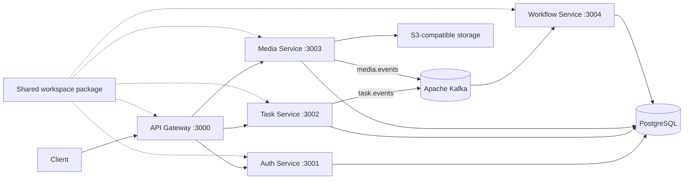
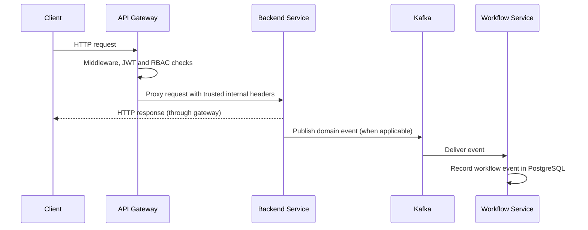

# Node.js Microservices

A TypeScript-based backend project demonstrating a **microservices architecture** using Express.js, PostgreSQL, Apache Kafka, and Docker. The system is organized into independently runnable services, with an API Gateway as the client-facing entry point and Kafka for asynchronous event communication.

> **Project status:** Development-oriented implementation. The README describes the current codebase; it does not imply that every service is independently data-isolated or production-ready.

## Architecture

The project follows a **microservices architecture** with an **API Gateway pattern** and **event-driven communication** for selected background workflows.

- **API Gateway:** Central entry point for client HTTP requests. It applies security middleware, rate limiting, JWT validation, role-based access checks, and proxies supported routes to backend services.
- **Independent services:** Authentication, task management, media attachments, and workflow-event processing run as separate applications with their own entry points.
- **Synchronous communication:** Client requests pass through the gateway to the relevant service over HTTP.
- **Asynchronous communication:** Task and media services publish domain events to Kafka; the workflow service consumes those events and records workflow activity.
- **Shared package:** Common infrastructure utilities are maintained in `packages/shared` to avoid duplicating cross-cutting code.

### High-level architecture



**Data and infrastructure note:** The current services use a shared `DATABASE_URL` and common PostgreSQL pool helper; database ownership is logical rather than isolated per service. PostgreSQL and S3-compatible storage are external dependencies and are not provisioned by the repository's Compose files.

### Request and event flow



## Microservices

| Application | Port | Responsibility |
|---|---:|---|
| **API Gateway** | `3000` | Client entry point; proxies authentication, task, and media routes; applies JWT/RBAC checks and common HTTP middleware. |
| **Auth Service** | `3001` | User registration and login, password hashing, JWT issuance, and authenticated user profile. |
| **Task Service** | `3002` | Task creation, retrieval, user-scoped listing, administrator deletion, and publishing task events to Kafka. |
| **Media Service** | `3003` | Task attachment upload and listing; stores files in S3-compatible storage and publishes media events. |
| **Workflow Service** | `3004` | Consumes task and media Kafka events and stores workflow records. Its workflow query logic is not currently exposed through a mounted HTTP route. |
| **Shared Package** | — | Reusable PostgreSQL, JWT/authentication, Kafka, validation, logging, response, and error-handling utilities. |

Each application has its own `src/index.ts` entry point and can be started independently. The gateway currently proxies only `/auth`, `/tasks`, and `/media`.

## Technology Stack

| Area | Technologies |
|---|---|
| Runtime and language | Node.js, TypeScript |
| HTTP framework | Express 5 |
| API Gateway | `http-proxy-middleware`, Helmet, CORS, `express-rate-limit` |
| Database | PostgreSQL, `pg` connection pool, SQL migrations |
| Messaging | Apache Kafka, KafkaJS |
| Authentication | JWT (`jsonwebtoken`), bcryptjs, role-based access control |
| Validation | Zod |
| File storage | AWS SDK for S3-compatible object storage |
| Logging | Pino, `pino-http` |
| Workspace and execution | npm workspaces, `tsx` |
| Containerization | Docker, Docker Compose |

## Project Structure

```text
nodejs-microservices/
├── apps/
│   ├── api-gateway/       # Gateway, proxy configuration and RBAC
│   ├── auth-service/      # Registration, login and user identity
│   ├── task-service/      # Task APIs and task event producer
│   ├── media-service/     # Attachment APIs, storage and event producer
│   └── workflow-service/  # Kafka event consumer and workflow records
├── packages/
│   └── shared/            # Shared auth, database, Kafka and utilities
├── sql/                   # Ordered PostgreSQL migration files
├── scripts/               # Database migration runner
├── docker/                # Kafka-only Compose configuration
├── docker-compose.yml     # Application services and Kafka orchestration
├── dockerfile             # Node.js application image definition
├── package.json           # Root scripts and npm workspaces
└── tsconfig.base.json     # Shared TypeScript configuration
```

## API Overview

The API Gateway is the intended client entry point at `http://localhost:3000`.

| Method | Endpoint | Service | Description |
|---|---|---|---|
| `GET` | `/health` | Gateway | Gateway health response |
| `POST` | `/auth/register` | Auth | Register a user |
| `POST` | `/auth/login` | Auth | Authenticate and receive a JWT |
| `GET` | `/auth/me` | Auth | Get the authenticated user's profile |
| `POST` | `/tasks` | Task | Create a task |
| `GET` | `/tasks` | Task | List the caller's tasks (admins can list all) |
| `GET` | `/tasks/:id` | Task | Get a task by ID, subject to ownership rules |
| `DELETE` | `/tasks/:id` | Task | Delete a task (admin only) |
| `POST` | `/media/:taskId/attachments` | Media | Upload an image attachment (`image` multipart field) |
| `GET` | `/media/:taskId/attachments` | Media | List task attachments |

Protected routes use bearer JWT authentication at the gateway. The gateway forwards verified identity information and an internal gateway secret to protected services. Each service also exposes its own `/health` endpoint on its service port.

## Database and Messaging

### PostgreSQL

- PostgreSQL access uses the Node.js `pg` driver and a shared connection-pool helper.
- SQL schema changes are maintained as ordered files in `sql/` and applied by the custom migration runner.
- Current tables include `users`, `tasks`, `attachments`, and `task_workflows`.
- Services share the configured database; the current implementation does not provide a separate database per service.

Run migrations from the repository root:

```bash
npm run db:migrate
```

### Kafka events

| Producer | Topic | Consumer | Purpose |
|---|---|---|---|
| Task Service | `task.events` | Workflow Service | Records task-related events such as task creation |
| Media Service | `media.events` | Workflow Service | Records attachment-upload events |

Kafka is used for asynchronous event processing; normal client API requests use HTTP through the gateway.

## Getting Started

### Prerequisites

- Node.js 22 recommended
- npm
- PostgreSQL
- Docker and Docker Compose for Kafka/container workflows
- An S3-compatible storage endpoint and bucket for media uploads

### 1. Clone and install

```bash
git clone <repository-url>
cd nodejs-microservices
npm ci
```

### 2. Configure environment

Create a root `.env` file and configure the variables required by the services. At minimum, database-backed functionality needs `DATABASE_URL`; protected gateway/service requests need `GATEWAY_SECRET` and `JWT_SECRET`; Kafka-backed services need a reachable `KAFKA_BROKERS` broker. Media uploads additionally require `AWS_ENDPOINT_URL_S3`, `AWS_ACCESS_KEY_ID`, `AWS_SECRET_ACCESS_KEY`, `AWS_REGION`, and `STORAGE_BUCKET`.

Use your own local values. Do not commit secrets.

### 3. Start Kafka

```bash
npm run kafka:up
```

To view logs or stop Kafka:

```bash
npm run kafka:logs
npm run kafka:down
```

### 4. Prepare the database

Make sure PostgreSQL is running and `DATABASE_URL` points to it, then run:

```bash
npm run db:migrate
```

The application Compose configuration does not provision PostgreSQL or S3-compatible storage; configure those separately.

### 5. Run services

Run each command in a separate terminal from the repository root:

```bash
npm run dev:gateway
npm run dev:auth
npm run dev:task
npm run dev:media
npm run dev:workflow
```

### 6. Run with Docker Compose

```bash
docker compose up --build
```

**Current configuration caveat:** The Compose file references `Dockerfile`, while the repository contains a lowercase `dockerfile`. Resolve that filename mismatch before running the application Compose setup on case-sensitive systems. The current application containers use development commands and source bind mounts; this is not a production deployment configuration.

## Engineering Concepts Demonstrated

- Microservices architecture with separately runnable service applications
- API Gateway pattern for routing and centralized request checks
- Event-driven architecture using Kafka producers and consumers
- JWT-based authentication and role-based authorization
- Shared infrastructure utilities through an npm workspace package
- PostgreSQL connection pooling and versioned SQL migrations
- Object storage integration for media attachments
- Docker-based service orchestration

## Current Scope and Limitations

- The workflow service consumes events, but its workflow query functionality is not currently exposed through a mounted HTTP API or gateway route.
- Services share one PostgreSQL database and connection-helper implementation; database-per-service isolation is not implemented.
- Kafka event publishing is best-effort in the current implementation; durable retry, dead-letter handling, and idempotent processing are not implemented.
- PostgreSQL and S3-compatible storage must be provided externally.
- The repository does not currently include an automated test suite or a production deployment pipeline.

---

**Built with Node.js, TypeScript, Express.js, PostgreSQL, Apache Kafka, and Docker.**
# nodejs-microservices

